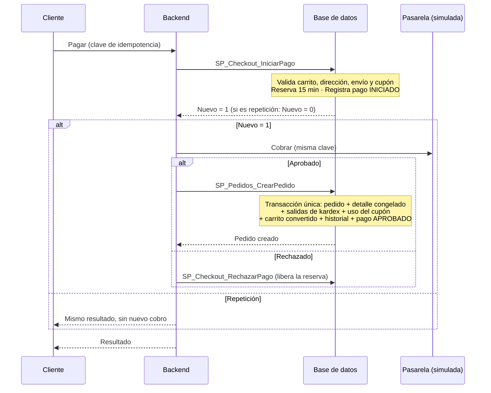
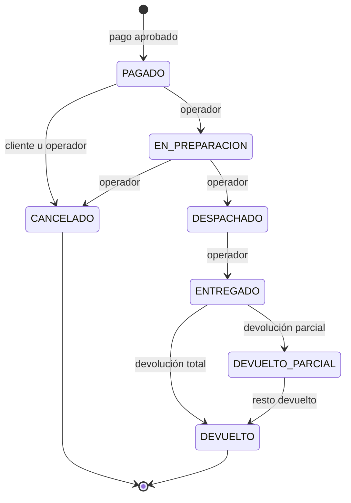

# ShopCart 🛒

Plataforma de comercio electrónico desarrollada como parte del **Tech Challenge 360 de Grupo Pentandra**. El proyecto busca ofrecer una solución full-stack para la venta de productos en línea, con gestión de catálogo, inventario, promociones, pedidos y reportes.

> **Estado del proyecto:** En desarrollo. La **base de datos está completa** (27 scripts SQL, 9 módulos). El backend y el frontend se documentarán conforme avance su implementación.

## 📋 Tabla de contenidos

- [Descripción](#-descripción)
- [Objetivos](#-objetivos)
- [Stack tecnológico](#-stack-tecnológico)
- [Arquitectura](#-arquitectura)
- [Módulos funcionales](#-módulos-funcionales)
- [Requisitos previos](#-requisitos-previos)
- [Instalación y ejecución](#-instalación-y-ejecución)
- [Configuración](#-configuración)
- [Base de datos](#-base-de-datos)
- [Reglas de negocio](#-reglas-de-negocio)
- [Flujo de pedidos](#-flujo-de-pedidos)
- [Seguridad e integridad](#-seguridad-e-integridad)
- [Catálogo de códigos de error](#-catálogo-de-códigos-de-error)
- [Pruebas](#-pruebas)
- [Credenciales de prueba](#-credenciales-de-prueba)
- [Decisiones técnicas](#-decisiones-técnicas)
- [Supuestos y decisiones abiertas](#-supuestos-y-decisiones-abiertas)
- [Mejoras posibles](#-mejoras-posibles)
- [Plan de desarrollo](#-plan-de-desarrollo)

## 📖 Descripción

ShopCart es una plataforma web de comercio electrónico que permite a los clientes consultar un catálogo de productos, administrar su carrito y realizar compras. También proporciona herramientas para que el personal interno gestione el catálogo, el inventario, los pedidos, los cupones y los reportes de ventas.

El proyecto se desarrolla bajo una arquitectura de monorepo, manteniendo el frontend, el backend y los scripts de base de datos dentro de un único repositorio Git.

## 🎯 Objetivos

- Desarrollar una plataforma de comercio electrónico funcional y mantenible.
- Garantizar la integridad de las operaciones de compra e inventario.
- Implementar autenticación y autorización basada en roles.
- Centralizar el acceso a datos mediante Stored Procedures.
- Mantener trazabilidad de los movimientos de inventario y los cambios administrativos.
- Facilitar la instalación, ejecución y evaluación técnica del proyecto.

## 🧰 Stack tecnológico

| Componente | Tecnología |
|---|---|
| Frontend | React 18 o superior + TypeScript |
| Backend | Node.js 24 LTS o superior + Express + TypeScript |
| Base de datos | Microsoft SQL Server 2019 o superior (T-SQL) |
| Acceso a datos | Stored Procedures con parámetros tipados; sin ORM |
| Autenticación | JWT y refresh tokens con rotación |
| Control de versiones | Git y GitHub |
| Arquitectura del repositorio | Monorepo |

Las librerías complementarias y sus versiones se documentarán conforme se definan en la implementación.

## 🏗️ Arquitectura

El repositorio sigue una organización por aplicaciones y responsabilidades:

```text
shopcart/
├── apps/
│   ├── api/              # Backend REST
│   └── web/              # Aplicación React
├── database/
│   ├── scripts/          # 27 scripts SQL numerados (001 a 027)
│   └── README.md         # Ejecución, orden de scripts y catálogo de objetos
├── docs/
│   ├── er-diagram.md     # Diagrama entidad-relación
│   └── architecture.md
├── .editorconfig
├── .gitignore
├── package.json
└── README.md
```

### Backend

El backend se organiza en capas para separar las responsabilidades:

- **Routes / Controllers:** recepción de solicitudes HTTP y construcción de respuestas.
- **Services:** reglas de negocio y coordinación de operaciones.
- **Data Access:** invocación de Stored Procedures y manejo de resultados.
- **Middlewares:** autenticación, autorización, validación y manejo centralizado de errores.
- **Config:** configuración mediante variables de entorno.

El middleware de errores traduce los códigos personalizados de la base de datos a respuestas HTTP según el [catálogo de códigos de error](#-catálogo-de-códigos-de-error).

### Frontend

El frontend se organiza por funcionalidades y componentes reutilizables, con rutas protegidas, formularios validados, estados de carga y error, y vistas adaptadas a distintos tamaños de pantalla.

### Base de datos

SQL Server almacena la información del negocio y aplica las restricciones necesarias para proteger la integridad de los datos. El acceso a datos se realiza exclusivamente mediante Stored Procedures; no se utiliza un ORM para generar objetos ni consultas de base de datos. La sección [Base de datos](/database) describe el modelo, la seguridad y las decisiones de diseño.

## 🧩 Módulos funcionales

La solución contempla los siguientes módulos, de acuerdo con el enunciado:

1. **Autenticación y control de acceso:** registro, inicio de sesión y roles de Cliente, Operador y Administrador.
2. **Catálogo:** gestión de categorías, productos, variantes, SKU, precios y búsqueda.
3. **Inventario:** existencias disponibles, reservas y kardex de movimientos.
4. **Carrito:** gestión de artículos, cantidades, subtotales y descuentos.
5. **Cupones y promociones:** vigencia, restricciones y límites de uso.
6. **Checkout y pago:** dirección de entrega, reserva de existencias y creación consistente del pedido.
7. **Pedidos y devoluciones:** seguimiento de estados, cancelaciones y devoluciones parciales o totales.
8. **Dashboard y reportes:** ventas por periodo, ventas por categoría y productos más vendidos.
9. **Bitácora:** trazabilidad de cambios administrativos y operativos.

### Estado de implementación por módulo

| # | Módulo | Base de datos | Backend | Frontend |
|---|---|---|---|---|
| 1 | Autenticación y control de acceso | ✅ | ⏳ | ⏳ |
| 2 | Catálogo | ✅ | ⏳ | ⏳ |
| 3 | Inventario | ✅ | ⏳ | ⏳ |
| 4 | Carrito | ✅ | ⏳ | ⏳ |
| 5 | Cupones y promociones | ✅ | ⏳ | ⏳ |
| 6 | Checkout y pago | ✅ | ⏳ | ⏳ |
| 7 | Pedidos y devoluciones | ✅ | ⏳ | ⏳ |
| 8 | Dashboard y reportes | ✅ | ⏳ | ⏳ |
| 9 | Bitácora | ✅ | ⏳ | ⏳ |

✅ implementado · ⏳ pendiente. Los scripts de base de datos están escritos y se validan al ejecutarlos en el entorno local; el backend y el frontend se marcarán a medida que se verifiquen.

## 💻 Requisitos previos

Antes de ejecutar el proyecto, instala:

- Git.
- Node.js 24 LTS o superior y npm.
- Microsoft SQL Server 2019 o superior (instalado localmente o en contenedor).
- La utilidad `sqlcmd` para ejecutar los scripts desde la línea de comandos. Como alternativa, SQL Server Management Studio (SSMS) o Azure Data Studio ejecutando los scripts en orden.

## 🚀 Instalación y ejecución

### 1. Clonar el repositorio

```bash
git clone https://github.com/WilverEmilio/shopcart.git
cd shopcart
```

### 2. Instalar dependencias

Cuando se configure npm workspaces en la raíz del monorepo:

```bash
npm install
```

### 3. Configurar las variables de entorno

Copia el archivo `.env.example` de la aplicación correspondiente a un archivo `.env` local y configura las variables requeridas.

### 4. Preparar la base de datos

Los 27 scripts de `database/scripts/` se ejecutan **en orden numérico sobre una base nueva**. La contraseña del usuario de la aplicación se pasa como variable (nunca se guarda en el repositorio).

```bash
export SA_PASSWORD='<contraseña de sa>'
export APP_PASSWORD='<contraseña para shopcart_app>'

for f in database/scripts/*.sql; do
  echo ">> $f"
  sqlcmd -S localhost -U sa -P "$SA_PASSWORD" -b -f 65001 -v AppPassword="$APP_PASSWORD" -i "$f" || break
done
```

Las instrucciones para PowerShell, cómo reiniciar la base de datos y el detalle de cada script están en [`database/README.md`](/database/README.MD).

Al terminar, la base contiene el catálogo, los cupones, 3,000 pedidos de demostración y la configuración inicial. El administrador de prueba se crea con el script de semillas del backend (ver [Credenciales de prueba](#-credenciales-de-prueba)).

### 5. Ejecutar las aplicaciones

Los comandos definitivos se documentarán cuando estén configurados los scripts del monorepo y de cada aplicación.

> **Nota:** las instrucciones de los pasos 2, 3 y 5 describen el procedimiento previsto. Los comandos de ejecución completos estarán disponibles cuando se hayan creado y configurado los proyectos de backend y frontend.

## ⚙️ Configuración

Las variables de entorno se utilizarán para gestionar la configuración de cada aplicación.

Ejemplo conceptual para el backend; los nombres definitivos dependerán de la implementación:

```dotenv
NODE_ENV=development
PORT=3000

DB_SERVER=localhost
DB_PORT=1433
DB_NAME=ShopCart
DB_USER=shopcart_app
DB_PASSWORD=
DB_ENCRYPT=false
DB_TRUST_SERVER_CERTIFICATE=true

JWT_ACCESS_SECRET=
JWT_REFRESH_SECRET=
```

Este bloque es una referencia inicial, no un archivo de configuración validado. Los nombres y valores deben ajustarse a la librería de conexión elegida y a la configuración de SQL Server.

- La aplicación se conecta con el usuario **`shopcart_app`**, que solo puede ejecutar stored procedures. No debe usarse `sa`.
- El archivo `.env.example` contendrá únicamente valores ilustrativos y ninguna credencial real.

Parámetros de negocio configurables en la propia base de datos (tabla `Configuracion`, modificables por el Administrador):

| Clave | Valor inicial | Uso |
|---|---|---|
| `OffsetHorasLocal` | `-6` | Diferencia entre la hora local (Guatemala) y UTC; agrupa los reportes por día |
| `AbandonoCarritoHoras` | `24` | Horas sin actividad para considerar abandonado un carrito con productos |

## 🗄️ Base de datos

Modelo relacional normalizado de **30 tablas**, **87 stored procedures** (77 públicos en `dbo` y 10 internos en el esquema `Interno`), **4 funciones tipo tabla, 6 vistas y 11 triggers**, creados con scripts SQL propios y versionados.

- Diagrama entidad-relación: [`docs/er-diagram.md`](docs/er-diagram.md).
- Orden de scripts, ejecución y catálogo completo de procedimientos: [`database/README.md`](database/README.md).

| Módulo | Tablas principales |
|---|---|
| Seguridad y bitácora | `Roles`, `Permisos`, `RolesPermisos`, `Usuarios`, `TokensRefresco`, `Bitacora` |
| Catálogo | `Categorias`, `Productos`, `ImagenesProducto`, `Atributos`, `Variantes`, `VarianteAtributos` |
| Inventario | `MovimientosInventario` (kardex), `Reservas`, `ReservasDetalle` |
| Carrito | `Carritos`, `CarritosDetalle` |
| Cupones | `Cupones`, `UsosCupones` |
| Checkout y pedidos | `MetodosEnvio`, `Direcciones`, `Pedidos`, `DetallePedidos`, `HistorialEstadosPedido`, `Pagos` |
| Devoluciones y estados | `TransicionesEstadoPedido`, `Devoluciones`, `DetalleDevoluciones` |
| Sistema | `Configuracion`, `VersionesEsquema` |

### Estándares de implementación

- Llaves primarias y foráneas; restricciones `UNIQUE`, `NOT NULL` y `CHECK` donde aplica (62 restricciones `CHECK` con nombre).
- Tipos `DECIMAL` o `INTEGER` con precisión definida para montos y cantidades; **no se usa `FLOAT` ni `REAL`**.
- Scripts SQL numerados y versionados (`001` a `027`); cada uno se registra en `VersionesEsquema`.
- Stored Procedures para **todas** las operaciones de lectura y escritura.
- Transacciones para las operaciones que requieren atomicidad (`SET XACT_ABORT ON` + `TRY/CATCH`).
- Parámetros tipados: no hay SQL concatenado. Los listados con orden variable usan `CASE` en `ORDER BY` y los datos estructurados se reciben como JSON leído con `OPENJSON`.
- Nomenclatura conforme al estándar del reto:

| Objeto | Formato | Ejemplo |
|---|---|---|
| Stored procedure | `SP_Modulo_Proceso` | `SP_Pedidos_CrearPedido`, `SP_Inventario_ReservarExistencia` |
| Vista | `VW_Modulo_Proceso` | `VW_Dashboard_VentasPorLinea`, `VW_Pedidos_Historial` |
| Función tipo tabla | `FU_Modulo_Proceso` | `FU_Cupones_CalculoDescuento` |
| Llave primaria | `ID` + nombre | `IDProducto`, `IDPedido`, `IDCupon` |

### Moneda e impuestos

La moneda del sistema es el quetzal guatemalteco (GTQ) y **los precios publicados incluyen IVA del 12 %**. El desglose se calcula una sola vez sobre el total: `BaseImponible = ROUND(Total / 1.12, 2)` e `IVA = Total − BaseImponible`, de modo que base más IVA siempre suman exactamente el total. Como los precios son `DECIMAL(12,2)` y las cantidades enteras, `precio × cantidad` es exacto y no se acumulan errores de redondeo. El único otro redondeo es el del descuento porcentual de un cupón.

### Fechas y zona horaria

Todas las fechas se guardan en UTC. Los reportes reciben fechas locales, las convierten a UTC con `Configuracion.OffsetHorasLocal` y agrupan por día local.

### Tareas programadas

El backend debe ejecutar cada minuto:

| Procedimiento | Efecto |
|---|---|
| `SP_Inventario_LiberarReservasVencidas` | Libera las reservas de 15 minutos vencidas, sin intervención manual |
| `SP_Checkout_ExpirarPagos` | Marca como `EXPIRADO` los pagos cuya reserva ya no está vigente |

Si el job se cae, el stock no queda bloqueado: al reservar, el propio procedimiento libera las reservas vencidas de las variantes involucradas.

### Datos semilla

Catálogo (8 categorías, 6 productos curados y 400 de prueba con 1,200 variantes), 6 cupones (uno por caso de prueba), 3 métodos de envío, y **3,000 pedidos de demostración** de los últimos 120 días en todos los estados, con historial, devoluciones y movimientos de kardex coherentes, para validar que los listados y reportes responden en menos de 1 segundo. Una de cada 7 variantes queda sin existencia y `TEN-DEP-42-BLA` queda con 1 unidad, para probar la competencia por la última unidad.

## 📐 Reglas de negocio

### Existencias, reservas y kardex

- La **existencia disponible** es la física menos la reservada. Ambas son contadores en `Variantes`, protegidos por `CHECK (0 ≤ Reservada ≤ Fisica)`: la sobreventa es imposible aunque falle el código.
- El **kardex** (`MovimientosInventario`) es la fuente de verdad: cada entrada, salida, ajuste, devolución y cancelación queda registrada con usuario, fecha, motivo y cantidad (con signo). La existencia física **siempre** es igual a la suma de sus movimientos (`VW_Inventario_Conciliacion`). Es inmutable: se corrige con un ajuste.
- Un **ajuste** exige motivo y no puede dejar la existencia en negativo ni por debajo de lo reservado.
- Al **iniciar el pago** se reserva la existencia de cada variante durante 15 minutos (todo o nada). Si dos clientes piden la última unidad, solo uno la obtiene y el otro recibe un mensaje claro con el SKU y la cantidad disponible.
- Un usuario solo puede tener **una reserva activa**; iniciar otra libera la anterior, y modificar el carrito también la libera.
- La **salida del kardex** se registra al confirmarse el pago (la reserva se consume), no al despachar.

### Carrito

- Se identifica por el usuario del JWT o por un **token de invitado** del que solo se guarda el hash SHA-256. El cliente nunca envía un identificador de carrito.
- No guarda precios (muestra el vigente) y **no reserva** existencias; valida contra la disponible al agregar o modificar.
- Al iniciar sesión, el carrito del invitado se **fusiona** con el del usuario; las cantidades se recortan a lo disponible y se informan los ajustes.
- Un carrito es **abandonado** si está activo, tiene productos y no registra actividad durante `AbandonoCarritoHoras`.

### Cupones

- Tipo `PORCENTAJE` o `MONTO_FIJO`, con vigencia, monto mínimo de compra, límite total de usos, límite por cliente, y alcance a todo el carrito o a una categoría. **Solo un cupón por pedido.**
- El descuento se calcula una sola vez (`FU_Cupones_CalculoDescuento`) y se **limita al subtotal elegible**: nunca deja el total del pedido por debajo de cero.
- Rechazos con mensaje específico: inactivo, aún no vigente, vencido, agotado, límite por cliente alcanzado, carrito vacío, sin productos de la categoría y monto mínimo no alcanzado.
- Aplicar un cupón al carrito solo **valida**; el uso se consume al crear el pedido, con un `UPDATE` condicionado que respeta el límite total aunque varios clientes lo usen a la vez.
- Cancelar un pedido antes del despacho **libera** el uso del cupón; una devolución no.

### Checkout y pago

El pago se hace en dos pasos coordinados por el backend; la pasarela de pago es simulada pero recibe la misma clave de idempotencia:



- **Idempotencia:** la llave única `(IDUsuario, ClaveIdempotencia)` garantiza un solo pago y un solo pedido por solicitud. Repetir la solicitud (doble clic, reintento por falla de red) devuelve el mismo resultado; reutilizar la clave con otra dirección o envío se rechaza.
- **Atomicidad:** `SP_Pedidos_CrearPedido` guarda pedido, detalle, movimientos de inventario y uso del cupón juntos o no guarda nada.
- **Pago `ANULADO`:** si el cobro ya se aprobó pero el pedido no puede completarse (la reserva venció, el cupón se agotó justo antes o un precio cambió), no queda nada a medias: se libera la reserva, el pago queda `ANULADO` con su motivo y **el backend debe reembolsar** el cobro.
- **Precio congelado:** el pedido guarda una copia de precios, descuento (prorrateado por línea), envío, IVA y dirección. Triggers impiden modificarla: un cambio de precio posterior no altera pedidos ya realizados.
- **Un solo intento activo por usuario:** iniciar un segundo pago libera la reserva del primero.

### Definición de venta (reportes)

- Se cuentan los pedidos **pagados y no cancelados**; se excluyen `CANCELADO` y `DEVUELTO` (devuelto por completo).
- **Venta neta** = total del pedido − devoluciones. La devolución se descuenta del periodo del pedido original.
- **Ticket promedio** = venta neta entre el número de pedidos del periodo.
- Las ventas por categoría y por producto se calculan sobre las líneas (sin envío), netas de descuento y devoluciones, con la categoría vigente del producto.

### Devoluciones

- Totales o parciales por línea, solo sobre pedidos `ENTREGADO` o con devolución parcial previa. No se puede devolver más de lo vendido en cada línea.
- Reembolso = precio × unidades − descuento del cupón prorrateado por unidades (el **envío no se reembolsa**). El cálculo es acumulado por línea, así la suma de devoluciones parciales es exacta.
- Reintegran la existencia con movimientos `DEVOLUCION` en el kardex y se reflejan en los reportes.

## 🔄 Flujo de pedidos

El ciclo de vida se valida **en el backend y en la base de datos**: la tabla `TransicionesEstadoPedido` define las transiciones permitidas, los procedimientos las comprueban con un mensaje claro, y el trigger `TR_Pedidos_ValidarTransicion` impide cualquier otra, incluso con un `UPDATE` directo.



| Estado | Significado | Siguientes estados |
|---|---|---|
| `PAGADO` | Pedido creado con el pago aprobado | `EN_PREPARACION`, `CANCELADO` |
| `EN_PREPARACION` | El operador lo está preparando | `DESPACHADO`, `CANCELADO` |
| `DESPACHADO` | Salió de la tienda | `ENTREGADO` |
| `ENTREGADO` | El cliente lo recibió | `DEVUELTO_PARCIAL`, `DEVUELTO` |
| `DEVUELTO_PARCIAL` | Se devolvió parte de las unidades | `DEVUELTO` (más devoluciones parciales no cambian el estado) |
| `CANCELADO` | Cancelado antes del despacho (final) | — |
| `DEVUELTO` | Devuelto por completo (final) | — |

**Quién puede qué**

- **Cliente:** consulta el estado y el historial de sus pedidos; puede cancelar el suyo **solo mientras esté `PAGADO`** (antes de que se empiece a preparar).
- **Operador y Administrador:** preparan, despachan y entregan; cancelan en `PAGADO` o `EN_PREPARACION`; registran devoluciones.
- Cada cambio queda en `HistorialEstadosPedido` (usuario, fecha y hora, estado anterior y nuevo) y en la bitácora.
- Cancelar reintegra la existencia con movimientos `CANCELACION` y libera el cupón. Una reserva vencida libera su existencia sin intervención manual.

## 🔐 Seguridad e integridad

| Control | Cómo se implementa | BD | Backend |
|---|---|---|---|
| Contraseñas con hash seguro | La BD solo almacena el hash que genera el backend | ✅ | ⏳ |
| JWT de corta duración + refresh token con rotación | `TokensRefresco` guarda solo el hash del token; la rotación es atómica y detecta la reutilización de un token ya rotado (cierra todas las sesiones) | ✅ | ⏳ |
| Autorización por rol y permisos | Matriz fija rol → permisos; cada SP de escritura valida el permiso **dentro de la base de datos** | ✅ | ⏳ |
| Aislamiento de datos de cada cliente | Los SPs filtran siempre por el `IDUsuario` del JWT; las direcciones, pedidos y carritos ajenos responden "no existe" | ✅ | ⏳ |
| Acceso a datos solo con SPs | El usuario `shopcart_app` solo tiene `EXECUTE` sobre `dbo` y tiene denegado el acceso a las tablas | ✅ | — |
| Operaciones críticas no invocables por la app | Los SPs sensibles viven en el esquema `Interno`, sin permiso para la aplicación | ✅ | — |
| Prevención de SQL injection | Parámetros tipados; sin SQL concatenado ni dinámico | ✅ | ⏳ |
| Operaciones transaccionales | `XACT_ABORT` + `TRY/CATCH` + `ROLLBACK` en toda escritura | ✅ | — |
| Concurrencia | Bloqueos de actualización, `UPDATE` condicionados e índices únicos filtrados en reservas, cupones y carritos | ✅ | ⏳ reintento ante deadlock |
| Idempotencia del pago | Clave única por usuario y solicitud | ✅ | ⏳ |
| Bitácora inmutable | Trigger `INSTEAD OF UPDATE, DELETE`; además la app no tiene acceso a la tabla | ✅ | — |
| Kardex, historial de estados y devoluciones inmutables | Triggers `INSTEAD OF UPDATE, DELETE` | ✅ | — |
| Pedidos congelados | Triggers impiden modificar montos, precios y datos de envío | ✅ | — |
| Usuarios y pedidos no se eliminan | Triggers `INSTEAD OF DELETE`; los usuarios se desactivan | ✅ | — |
| Credenciales fuera del repositorio | Contraseña del usuario de la app por variable `sqlcmd`; `.env` ignorado | ✅ | ⏳ |
| CORS y cabeceras de seguridad, validación de entradas, manejo de errores | Middlewares del backend | — | ⏳ |

La bitácora registra creación, modificación, desactivación, eliminación y cambios de estado de categorías, productos, variantes, precios, existencias, cupones, usuarios, pedidos y configuración, con usuario, fecha y hora, entidad, acción, valor anterior y valor nuevo. Los administradores la consultan con filtro por módulo (`Usuarios`, `Catalogo`, `Productos`, `Precios`, `Inventario`, `Cupones`, `Pedidos`, `Configuracion`).

## 🚨 Catálogo de códigos de error

Los procedimientos almacenados señalan los errores de negocio con `THROW` y **códigos personalizados entre 50001 y 50132**, con un mensaje en español pensado para mostrarse al usuario. El middleware de errores del backend traduce cada código a un código HTTP según esta tabla y devuelve una respuesta consistente (`{ código, mensaje }`).

Criterio general: los errores **4xx** exponen el mensaje de la base de datos; los **500** indican un fallo interno o un intento de manipulación directa, y deben registrarse en el servidor y devolver un mensaje genérico al cliente.

### Autenticación, usuarios y bitácora

| Código | Significado | HTTP |
|---|---|---|
| 50001 | Configuración inválida (un rol requerido no existe) | 500 |
| 50010 | El correo ya está registrado | 409 |
| 50011 | Rol no permitido para esta operación (solo Operador o Administrador al crear usuarios internos) | 400 |
| 50012 | Usuario no encontrado | 404 |
| 50013 | El usuario no existe o está inactivo | 401 (en inicio de sesión y renovación de token) o 403 |
| 50014 | Un usuario no puede desactivarse a sí mismo | 409 |
| 50015 | No se puede desactivar al último administrador activo | 409 |
| 50016 | No tiene permisos para realizar la acción | 403 |
| 50020 | Token de refresco inválido, expirado o revocado | 401 |
| 50021 | Reutilización de un token de refresco detectada: se cerraron todas las sesiones | 401 |
| 50030 | La bitácora no puede modificarse ni eliminarse | 500 |
| 50031 | Los usuarios no se eliminan; se desactivan | 500 |

### Catálogo

| Código | Significado | HTTP |
|---|---|---|
| 50040 | Categoría no encontrada | 404 |
| 50041 | Ya existe una categoría con ese nombre | 409 |
| 50042 | La categoría tiene productos asociados y no puede eliminarse | 409 |
| 50050 | Producto no encontrado | 404 |
| 50051 | La categoría no existe o está inactiva | 400 |
| 50052 | El producto debe tener al menos una variante | 400 |
| 50053 | Datos de entrada inválidos (JSON o campos obligatorios; el mensaje indica cuál) | 400 |
| 50054 | SKU duplicado | 409 |
| 50055 | Combinación de atributos duplicada dentro del producto | 409 |
| 50056 | El atributo no existe o está inactivo | 400 |
| 50057 | Variante no encontrada | 404 |
| 50058 | Precio inválido (debe ser mayor a cero) | 400 |
| 50059 | Rango de precios inválido (mínimo mayor al máximo) | 400 |

### Inventario y reservas

| Código | Significado | HTTP |
|---|---|---|
| 50060 | El kardex no puede modificarse ni eliminarse (se corrige con un ajuste) | 500 |
| 50061 | La existencia no puede quedar en negativo | 409 |
| 50062 | La existencia reservada resultaría negativa (inconsistencia interna) | 500 |
| 50063 | El movimiento dejaría la existencia por debajo de las unidades reservadas | 409 |
| 50064 | Ya existe ese movimiento para la referencia indicada (protección contra duplicados) | 409 |
| 50066 | Cantidad inválida (cero, negativa o con signo incorrecto para el tipo) | 400 |
| 50067 | Existencias insuficientes; el mensaje indica el SKU, lo solicitado y lo disponible | 409 |
| 50068 | El producto no está disponible para la venta | 409 |
| 50069 | Reserva no encontrada | 404 |
| 50070 | La reserva venció o ya no está activa; hay que reiniciar el pago | 409 |
| 50071 | El motivo es obligatorio | 400 |
| 50072 | Ya hay un proceso de pago en curso para el usuario | 409 |

### Carrito

| Código | Significado | HTTP |
|---|---|---|
| 50080 | Debe indicarse el usuario o el token de invitado (solo uno de los dos) | 400 |
| 50081 | Carrito no encontrado | 404 |
| 50082 | La cantidad excede la existencia disponible; el mensaje indica el SKU y lo disponible | 409 |
| 50083 | El producto no está en el carrito | 404 |
| 50084 | El carrito se está modificando en otra solicitud; reintentar | 409 |

### Cupones

| Código | Significado | HTTP |
|---|---|---|
| 50090 | Ya existe un cupón con ese código | 409 |
| 50091 | Cupón no encontrado | 404 |
| 50093 | El límite total de usos no puede ser menor a los usos ya registrados | 409 |
| 50094 | El cupón ya fue utilizado: se desactiva en lugar de eliminarse | 409 |
| 50095 | **Cupón no aplicable**; el mensaje es específico y el `STATE` del error indica el motivo (tabla siguiente) | 409 |

Motivos de rechazo de un cupón (`STATE` del error 50095):

| STATE | Motivo | Mensaje |
|---|---|---|
| 1 | `INACTIVO` | El cupón no está activo. |
| 2 | `NO_VIGENTE` | El cupón aún no está vigente. |
| 3 | `VENCIDO` | El cupón está vencido. |
| 4 | `AGOTADO` | El cupón ya alcanzó su límite total de usos. |
| 5 | `LIMITE_CLIENTE` | Ya alcanzó el límite de usos de este cupón por cliente. |
| 6 | `CARRITO_VACIO` | El carrito está vacío; agregue productos para usar el cupón. |
| 7 | `SIN_PRODUCTOS_CATEGORIA` | El carrito no tiene productos de la categoría a la que aplica el cupón. |
| 8 | `MINIMO_NO_ALCANZADO` | La compra mínima para este cupón es Q… (incluye el monto). |

### Checkout, pedidos y devoluciones

| Código | Significado | HTTP |
|---|---|---|
| 50099 | Verificación interna de los datos semilla (solo durante la instalación) | — |
| 50100 | Dirección no encontrada | 404 |
| 50101 | Método de envío inválido | 400 |
| 50102 | El carrito está vacío | 409 |
| 50103 | Pedido no encontrado (también cuando pertenece a otro cliente) | 404 |
| 50110 | El total cambió desde que el cliente lo vio; el mensaje incluye el nuevo total | 409 |
| 50111 | La clave de idempotencia ya se usó con datos distintos | 422 |
| 50112 | Ya hay una solicitud de pago idéntica en proceso | 409 |
| 50113 | El pago no existe | 404 |
| 50114 | No fue posible completar el pedido tras el cobro: **no llega al cliente como error**; el procedimiento anula el pago, libera la reserva y devuelve `Estado = ANULADO` con el motivo (el backend debe reembolsar) | 200 con estado `ANULADO` |
| 50115 | Los pedidos y sus líneas no se eliminan; se cancelan | 500 |
| 50116 | Los montos y los datos de envío de un pedido están congelados | 500 |
| 50117 | El historial de estados no puede modificarse ni eliminarse | 500 |
| 50120 | Transición de estado no permitida; el mensaje indica el estado de origen y de destino | 409 |
| 50121 | Use la operación específica (cancelar o devolver) en lugar de avanzar el estado | 400 |
| 50122 | El cliente solo puede cancelar su pedido mientras esté `PAGADO` | 409 |
| 50123 | Solo se pueden devolver pedidos entregados | 409 |
| 50124 | No se puede devolver más de lo vendido en la línea; el mensaje indica el SKU y lo que queda por devolver | 409 |
| 50125 | Datos de devolución inválidos (líneas vacías, cantidades o líneas ajenas al pedido) | 400 |
| 50126 | Las devoluciones no pueden modificarse ni eliminarse | 500 |

### Reportes y configuración

| Código | Significado | HTTP |
|---|---|---|
| 50130 | Rango de fechas inválido (inicio posterior al fin, o más de 2 años) | 400 |
| 50131 | La clave de configuración no existe | 404 |
| 50132 | Valor de configuración inválido | 400 |

### Errores nativos de SQL Server que el backend debe contemplar

| Error | Causa | Acción recomendada |
|---|---|---|
| 1205 | Interbloqueo (*deadlock*): SQL Server eligió esta transacción como víctima | Reintentar hasta 3 veces con una espera corta; si persiste, responder 503 |
| 1222 | Tiempo de espera de bloqueo agotado | 503 |
| 2601, 2627 | Violación de índice o restricción `UNIQUE` no traducida por el procedimiento | 409 |
| 547 | Violación de `CHECK` o llave foránea | 400 o 409 según el contexto |
| 8152 | Texto demasiado largo para la columna | 400 |
| 245, 8114 | Error de conversión de tipos | 400 |

## 🧪 Pruebas

Se incorporarán pruebas para validar, como mínimo:

- Autenticación, permisos y aislamiento de los datos de cada cliente.
- Validación de entradas y manejo de errores.
- Reglas de negocio de los módulos.
- Concurrencia al reservar la última unidad disponible (la semilla deja `TEN-DEP-42-BLA` con 1 unidad).
- Idempotencia ante reintentos de pago (misma clave dos veces y en paralelo).
- Atomicidad de las transacciones de compra.
- Restricciones de uso de cupones, incluido el uso simultáneo de `ULTIMOCUPON` (límite total de 1).
- Transiciones de estado de pedidos y devoluciones.
- Consistencia entre existencias y movimientos del kardex.

La base de datos incluye consultas de verificación (conciliación de inventario y de cupones, y intentos de violar cada protección) en [`/database/README.MD`](/database/README.MD#verificaciones-rápidas). Los comandos para ejecutar las pruebas automáticas y sus resultados se documentarán una vez configurada la estrategia de testing.

## 🔑 Credenciales de prueba

Las credenciales de evaluación se documentarán aquí cuando existan usuarios semilla funcionales.

| Rol | Usuario | Contraseña |
|---|---|---|
| Administrador | Pendiente | Pendiente |
| Operador | Pendiente | Pendiente |
| Cliente | Pendiente | Pendiente |

La base de datos ya incluye **60 clientes de demostración** (`cliente01@demo.shopcart.local` a `cliente60@demo.shopcart.local`) y un usuario de sistema (`sistema@shopcart.local`), todos **sin contraseña válida**: existen para dar volumen a los datos de demostración y no pueden iniciar sesión. Los tres usuarios de la tabla anterior (con contraseña real) los creará el script de semillas del backend, porque requieren un hash generado por la aplicación.

No se deben incluir contraseñas reales, secretos de producción ni credenciales personales. Las credenciales de prueba deberán corresponder exclusivamente a un entorno local o de demostración.

## 🧠 Decisiones técnicas

Las decisiones relevantes se registran con su justificación y consecuencias.

| Decisión | Criterio |
|---|---|
| Monorepo | Mantener frontend, backend y base de datos en un único repositorio. |
| Arquitectura por capas | Separar la presentación HTTP, las reglas de negocio y el acceso a datos. |
| Stored Procedures | Cumplir el acceso exclusivo a datos exigido por el reto; el rol de la aplicación solo puede ejecutarlos. |
| Esquema `Interno` | Las operaciones críticas (mover existencias, consumir reservas, cambiar estados, consumir cupones) no son invocables por la aplicación; solo por otros procedimientos. |
| Permisos validados en la base de datos | Defensa en profundidad: aunque el backend fallara, la base rechaza la acción. |
| Existencia como contadores + kardex | El checkout necesita verificar y descontar la última unidad de forma atómica; recalcular una suma en cada compra sería lento y difícil de bloquear. El kardex es la fuente de verdad y una vista de conciliación comprueba que ambos coincidan. |
| Reserva de 15 minutos con consumo al pagar | Cumple el enunciado sin mantener reservas durante días; la salida del kardex ocurre al confirmar el pago. |
| Pago en dos pasos con clave de idempotencia | No se mantiene una transacción abierta durante la llamada a la pasarela, y las repeticiones devuelven el mismo resultado. |
| Pago `ANULADO` como compensación | Si el cobro se aprueba pero el pedido no puede completarse, no quedan datos a medias y se sabe que hay que reembolsar. |
| Copia congelada del pedido | El precio, el descuento y la dirección del pedido no cambian aunque cambie el catálogo; triggers lo garantizan. |
| Descuento prorrateado por línea | Permite calcular reembolsos exactos en devoluciones parciales. |
| Tabla de transiciones + trigger | El ciclo de vida del pedido se valida en la base de datos y se puede consultar y ajustar como datos. |
| Transacciones | Proteger la atomicidad de pedidos, inventario y cupones (`XACT_ABORT` + `TRY/CATCH`). |
| Idempotencia | Evitar operaciones duplicadas ante reintentos. |
| Soft delete | Un producto o variante con ventas, kardex o reservas se desactiva; sin historial se elimina. Usuarios y pedidos nunca se eliminan. |
| Manejo de dinero | `DECIMAL` de precisión definida; redondeo único y documentado; IVA incluido en el precio. |
| UTC en la base de datos | Las fechas se guardan en UTC y los reportes agrupan en hora local configurable. |
| Datos de demostración con volumen | 3,000 pedidos coherentes con el kardex para validar el rendimiento de listados y reportes. |
| JSON + `OPENJSON` para listas | Permite crear un producto con sus variantes en una transacción sin SQL dinámico. |
| Orden de bloqueos fijo | Carrito → pago → reserva y variantes en orden ascendente reducen los interbloqueos; el backend reintenta el error 1205. |

Las decisiones que aún no estén resueltas se documentarán en `docs/architecture.md`, incluyendo las alternativas evaluadas y sus trade-offs.

## 📝 Supuestos y decisiones abiertas

El enunciado deja abiertas algunas decisiones a propósito. Estas son las posturas adoptadas:

| Tema | Decisión |
|---|---|
| Qué es una "venta" | Pedido pagado y no cancelado; el devuelto por completo se excluye; la venta es neta de devoluciones y se atribuye al periodo del pedido original. |
| Quién puede cancelar | El cliente, solo su pedido y solo en `PAGADO`; el personal, en `PAGADO` o `EN_PREPARACION`. |
| Cuándo se devuelve | Solo pedidos entregados; devolución total o parcial por línea. |
| Reembolso en devoluciones | Precio por unidades menos el descuento prorrateado; no incluye el envío. Una cancelación reembolsa el total. |
| Reembolso real | La base de datos calcula y devuelve el monto; el backend lo ejecuta en la pasarela. |
| Costo de envío | Tres métodos configurados en datos; el costo incluye IVA y no recibe descuento de cupón. |
| Monto mínimo de un cupón por categoría | Se compara contra el subtotal de todo el carrito (monto de la compra). |
| Uso de cupón al cancelar | Se libera; una devolución no lo libera. |
| Categoría en los reportes | Se usa la categoría vigente del producto (no se guarda una copia por línea). |
| Carrito de invitado y cupones | Los cupones requieren sesión; el invitado inicia sesión y su carrito se fusiona. |
| Intento de pago simultáneo | Un solo intento activo por usuario; iniciar otro libera la reserva del anterior. |
| Hora local | Guatemala (UTC−6, sin horario de verano), configurable. |
| Imágenes de producto | Se guarda la URL o ruta relativa de la imagen (no el binario); los archivos se sirven como estáticos. |
| Precio publicado | Incluye IVA del 12 %; el desglose se calcula sobre el total. |

## 🔧 Mejoras posibles

- Guardar la categoría en cada línea de pedido para que los reportes históricos no cambien si se reclasifica un producto.
- Historial de precios con vigencia y precios programados.
- Registro explícito de reembolsos (tabla `Reembolsos`) con su estado en la pasarela.
- Almacenamiento externo (S3 o similar) para las imágenes de producto.
- Búsqueda de texto con Full-Text Search en lugar de `LIKE`.
- Administración de métodos de envío y atributos desde el panel.
- Mover `SP_Bitacora_Registrar` al esquema `Interno` para que la aplicación no pueda escribir en la bitácora directamente.
- Caché de reportes con invalidación y actualización en tiempo real del dashboard (extras opcionales del reto).

## 📅 Plan de desarrollo

| Fase | Entrega | Fecha límite | Avance |
|---|---|---|---|
| Fase 1 | Base de datos y backend | 2 de noviembre de 2026, 23:59 | Base de datos completa; backend en desarrollo |
| Fase 2 | Frontend y proyecto completo | 9 de noviembre de 2026, 23:59 | Pendiente |

Las fechas corresponden al enunciado del reto.

## 📌 Estado de implementación

Este README se actualizará conforme se completen y verifiquen los componentes del proyecto. La documentación final incluirá las instrucciones reproducibles de instalación, el diagrama entidad-relación, las decisiones técnicas definitivas, los comandos de ejecución y las credenciales de prueba.

---

Desarrollado como parte del **Tech Challenge 360 — ShopCart**.