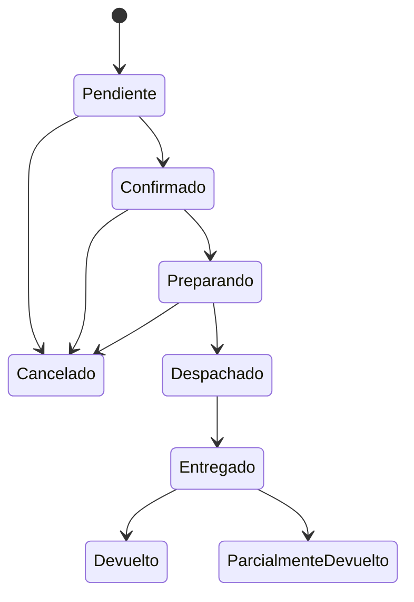

# ShopCart 🛒

Plataforma de comercio electrónico desarrollada como parte del **Tech Challenge 360 de Grupo Pentandra**. El proyecto busca ofrecer una solución full-stack para la venta de productos en línea, con gestión de catálogo, inventario, promociones, pedidos y reportes.

> **Estado del proyecto:** En desarrollo. La implementación de los módulos y sus pruebas se documentará conforme avance el proyecto.

## 📋 Tabla de contenidos

- [Descripción](#-descripción)
- [Objetivos](#-objetivos)
- [Stack tecnológico](#-stack-tecnológico)
- [Arquitectura](#-arquitectura)
- [Módulos funcionales](#-módulos-funcionales)
- [Requisitos previos](#-requisitos-previos)
- [Instalación y ejecución](#-instalación-y-ejecución)
- [Configuración](#-configuración)
- [Base de datos](#-base-de-datos)
- [Flujo de pedidos](#-flujo-de-pedidos)
- [Seguridad e integridad](#-seguridad-e-integridad)
- [Pruebas](#-pruebas)
- [Credenciales de prueba](#-credenciales-de-prueba)
- [Decisiones técnicas](#-decisiones-técnicas)
- [Plan de desarrollo](#-plan-de-desarrollo)

## 📖 Descripción

ShopCart es una plataforma web de comercio electrónico que permite a los clientes consultar un catálogo de productos, administrar su carrito y realizar compras. También proporciona herramientas para que el personal interno gestione el catálogo, el inventario, los pedidos, los cupones y los reportes de ventas.

El proyecto se desarrolla bajo una arquitectura de monorepo, manteniendo el frontend, el backend y los scripts de base de datos dentro de un único repositorio Git.

## 🎯 Objetivos

- Desarrollar una plataforma de comercio electrónico funcional y mantenible.
- Garantizar la integridad de las operaciones de compra e inventario.
- Implementar autenticación y autorización basada en roles.
- Centralizar el acceso a datos mediante Stored Procedures.
- Mantener trazabilidad de los movimientos de inventario y los cambios administrativos.
- Facilitar la instalación, ejecución y evaluación técnica del proyecto.

## 🧰 Stack tecnológico

| Componente | Tecnología |
|---|---|
| Frontend | React 18 o superior + TypeScript |
| Backend | Node.js 24 LTS o superior + Express + TypeScript |
| Base de datos | Microsoft SQL Server 2019 o superior |
| Acceso a datos | Stored Procedures con parámetros tipados |
| Autenticación | JWT y refresh tokens con rotación |
| Control de versiones | Git y GitHub |
| Arquitectura del repositorio | Monorepo |

Las librerías complementarias y sus versiones se documentarán conforme se definan en la implementación.

## 🏗️ Arquitectura

El repositorio sigue una organización por aplicaciones y responsabilidades:

```text
shopcart/
├── apps/
│   ├── api/              # Backend REST
│   └── web/              # Aplicación React
├── database/
│   ├── scripts/          # Scripts SQL versionados
│   └── README.md
├── docs/
│   ├── er-diagram.md
│   └── architecture.md
├── .editorconfig
├── .gitignore
├── package.json
└── README.md
```

### Backend

El backend se organiza en capas para separar las responsabilidades:

- **Routes / Controllers:** recepción de solicitudes HTTP y construcción de respuestas.
- **Services:** reglas de negocio y coordinación de operaciones.
- **Data Access:** invocación de Stored Procedures y manejo de resultados.
- **Middlewares:** autenticación, autorización, validación y manejo centralizado de errores.
- **Config:** configuración mediante variables de entorno.

### Frontend

El frontend se organiza por funcionalidades y componentes reutilizables, con rutas protegidas, formularios validados, estados de carga y error, y vistas adaptadas a distintos tamaños de pantalla.

### Base de datos

SQL Server almacena la información del negocio y aplica las restricciones necesarias para proteger la integridad de los datos. El acceso a datos se realizará exclusivamente mediante Stored Procedures; no se utilizará un ORM para generar objetos ni consultas de base de datos.

## 🧩 Módulos funcionales

La solución contempla los siguientes módulos, de acuerdo con el enunciado:

1. **Autenticación y control de acceso:** registro, inicio de sesión y roles de Cliente, Operador y Administrador.
2. **Catálogo:** gestión de categorías, productos, variantes, SKU, precios y búsqueda.
3. **Inventario:** existencias disponibles, reservas y kardex de movimientos.
4. **Carrito:** gestión de artículos, cantidades, subtotales y descuentos.
5. **Cupones y promociones:** vigencia, restricciones y límites de uso.
6. **Checkout y pago:** dirección de entrega, reserva de existencias y creación consistente del pedido.
7. **Pedidos y devoluciones:** seguimiento de estados, cancelaciones y devoluciones parciales o totales.
8. **Dashboard y reportes:** ventas por periodo, ventas por categoría y productos más vendidos.
9. **Bitácora:** trazabilidad de cambios administrativos y operativos.

La disponibilidad de cada módulo se actualizará a medida que se implemente y valide.

## 💻 Requisitos previos

Antes de ejecutar el proyecto, instala:

- Git.
- Node.js 24 LTS o superior y npm.
- Microsoft SQL Server 2019 o superior.
- SQL Server Management Studio (SSMS) o una herramienta compatible para ejecutar scripts SQL.

La configuración exacta del entorno se documentará una vez definida la estrategia de ejecución local.

## 🚀 Instalación y ejecución

### 1. Clonar el repositorio

```bash
git clone <URL_DEL_REPOSITORIO>
cd shopcart
```

### 2. Instalar dependencias

Cuando se configure npm workspaces en la raíz del monorepo:

```bash
npm install
```

### 3. Configurar las variables de entorno

Copia el archivo `.env.example` de la aplicación correspondiente a un archivo `.env` local y configura las variables requeridas.

No subas archivos `.env` ni credenciales reales al repositorio.

### 4. Preparar la base de datos

Ejecuta los scripts SQL versionados en el orden indicado en `database/README.md`. Configura la conexión de SQL Server con los datos de tu entorno local.

### 5. Ejecutar las aplicaciones

Los comandos definitivos se documentarán cuando estén configurados los scripts del monorepo y de cada aplicación.

> **Nota:** las instrucciones anteriores describen el procedimiento previsto. Los comandos de ejecución completos estarán disponibles cuando se hayan creado y configurado los proyectos.

## ⚙️ Configuración

Las variables de entorno se utilizarán para gestionar la configuración de cada aplicación.

Ejemplo conceptual para el backend; los nombres definitivos dependerán de la implementación:

```dotenv
NODE_ENV=development
PORT=3000

DB_SERVER=localhost
DB_PORT=1433
DB_NAME=ShopCart
DB_USER=
DB_PASSWORD=
DB_ENCRYPT=false
DB_TRUST_SERVER_CERTIFICATE=true

JWT_ACCESS_SECRET=
JWT_REFRESH_SECRET=
```

Este bloque es una referencia inicial, no un archivo de configuración validado. Los nombres y valores deben ajustarse a la librería de conexión elegida y a la configuración de SQL Server.

El archivo `.env.example` contendrá únicamente valores ilustrativos y ninguna credencial real.

## 🗄️ Base de datos

El modelo relacional se diseñará para representar usuarios, roles, categorías, productos, variantes, inventario, carritos, cupones, pedidos, direcciones y bitácora, entre otras entidades necesarias.

### Estándares de implementación

- Llaves primarias y foráneas.
- Restricciones `UNIQUE`, `NOT NULL` y `CHECK` según corresponda.
- Tipos `DECIMAL` o `INTEGER` con precisión definida para montos y cantidades; no utilizar `FLOAT` ni `REAL` para estos datos.
- Scripts SQL numerados y versionados.
- Stored Procedures para todas las operaciones de lectura y escritura.
- Transacciones para las operaciones que requieren atomicidad.
- Parámetros tipados para prevenir SQL injection.
- Nomenclatura de objetos conforme al estándar del reto.

Ejemplos de nombres de objetos:

- `SP_Pedidos_CrearPedido`
- `SP_Inventario_ReservarExistencia`
- `VW_Dashboard_VentasPorCategoria`

### Moneda e impuestos

La moneda del sistema será el quetzal guatemalteco (GTQ) y los precios publicados incluirán IVA del 12 %, conforme al enunciado.

### Diagrama entidad-relación

El diagrama se incorporará en `docs/er-diagram.md` o como un archivo gráfico dentro de `docs/` cuando el modelo de datos esté definido.

## 🔄 Flujo de pedidos

El ciclo de vida del pedido deberá definirse y validarse tanto en el backend como en la base de datos. El siguiente flujo es una **propuesta inicial**, pendiente de validación durante el diseño:



Las transiciones definitivas, sus restricciones y el tratamiento de las reservas vencidas, los pagos y las devoluciones se documentarán en función de las reglas de negocio implementadas.

## 🔐 Seguridad e integridad

El diseño contempla los siguientes controles:

- Contraseñas almacenadas mediante hash seguro.
- Access tokens JWT de corta duración y refresh tokens con rotación.
- Autorización basada en roles y propiedad de los recursos.
- Validación de datos en el backend.
- Manejo centralizado de errores y códigos HTTP consistentes.
- Configuración de CORS y cabeceras de seguridad.
- Prevención de SQL injection mediante parámetros tipados.
- Operaciones transaccionales para evitar registros incompletos.
- Control de concurrencia en reservas de inventario y uso de cupones.
- Idempotencia en las operaciones de pago.
- Bitácora de los cambios relevantes.

Estos controles se consideran objetivos de implementación y deberán verificarse mediante pruebas.

## 🧪 Pruebas

Se incorporarán pruebas para validar, como mínimo:

- Autenticación, permisos y aislamiento de los datos de cada cliente.
- Validación de entradas y manejo de errores.
- Reglas de negocio de los módulos.
- Concurrencia al reservar la última unidad disponible.
- Idempotencia ante reintentos de pago.
- Atomicidad de las transacciones de compra.
- Restricciones de uso de cupones.
- Transiciones de estado de pedidos y devoluciones.
- Consistencia entre existencias y movimientos del kardex.

Los comandos para ejecutar las pruebas y sus resultados se documentarán una vez configurada la estrategia de testing.

## 🔑 Credenciales de prueba

Las credenciales de evaluación se documentarán aquí cuando existan usuarios semilla funcionales.

| Rol | Usuario | Contraseña |
|---|---|---|
| Administrador | Pendiente | Pendiente |
| Operador | Pendiente | Pendiente |
| Cliente | Pendiente | Pendiente |

No se deben incluir contraseñas reales, secretos de producción ni credenciales personales. Las credenciales de prueba deberán corresponder exclusivamente a un entorno local o de demostración.

## 🧠 Decisiones técnicas

Las decisiones relevantes se registrarán con su justificación y consecuencias.

| Decisión | Criterio |
|---|---|
| Monorepo | Mantener frontend, backend y base de datos en un único repositorio. |
| Arquitectura por capas | Separar la presentación HTTP, las reglas de negocio y el acceso a datos. |
| Stored Procedures | Cumplir el acceso exclusivo a datos exigido por el reto. |
| Transacciones | Proteger la atomicidad de pedidos, inventario y cupones. |
| Idempotencia | Evitar operaciones duplicadas ante reintentos. |
| Soft delete | Conservar productos que tengan ventas asociadas. |
| Manejo de dinero | Utilizar tipos decimales de precisión definida y evitar errores de redondeo. |

Las decisiones que aún no estén resueltas se documentarán en `docs/architecture.md`, incluyendo las alternativas evaluadas y sus trade-offs.

## 📅 Plan de desarrollo

| Fase | Entrega | Fecha límite |
|---|---|---|
| Fase 1 | Base de datos y backend | 2 de noviembre de 2026, 23:59 |
| Fase 2 | Frontend y proyecto completo | 9 de noviembre de 2026, 23:59 |

Las fechas corresponden al enunciado del reto.

## 📌 Estado de implementación

Este README se actualizará conforme se completen y verifiquen los componentes del proyecto. La documentación final incluirá las instrucciones reproducibles de instalación, el diagrama entidad-relación, las decisiones técnicas definitivas, los comandos de ejecución y las credenciales de prueba.

---

Desarrollado como parte del **Tech Challenge 360 — ShopCart**.
