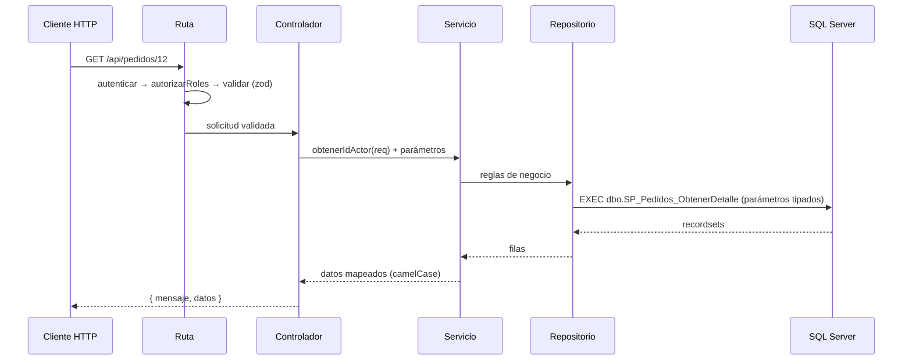

# ShopCart · API

Backend REST de ShopCart. Node.js 24 + Express + TypeScript (modo estricto). Todo el acceso a datos se hace con **stored procedures** de SQL Server, con parámetros tipados.

← [Volver al README principal](../../README.md) · Base de datos: [`database/README.md`](../../database/README.md) · Frontend: [`apps/frontend/README.md`](../frontend/README.md)

## Requisitos

- Node.js 24 o superior
- Base de datos `ShopCart` creada y poblada (ver [`database/README.md`](../../database/README.md))

## Instalación y scripts

```bash
cp .env.example .env     # edita DB_USER y DB_PASSWORD
npm install
npm run dev              # desarrollo con recarga (tsx watch), http://localhost:3000
```

| Script | Qué hace |
|---|---|
| `npm run dev` | Arranca `src/servidor.ts` con recarga automática |
| `npm run build` | Compila TypeScript a `dist/` |
| `npm start` | Ejecuta la versión compilada (`dist/servidor.js`) |
| `npx tsc --noEmit` | Verifica tipos sin generar archivos |
| `node scripts/prueba-concurrencia.mjs` | Prueba de la última unidad y de la idempotencia del pago |

Comprobación rápida: `GET http://localhost:3000/api/estado` responde `API funcionando correctamente`.

## Variables de entorno

| Variable | Descripción | Por defecto |
|---|---|---|
| `PORT` | Puerto HTTP | `3000` |
| `DB_SERVER`, `DB_PORT`, `DB_DATABASE` | Conexión a SQL Server | `localhost`, `1433`, `ShopCart` |
| `DB_USER`, `DB_PASSWORD` | Credenciales de SQL Server (**obligatorias**) | — |
| `DB_ENCRYPT`, `DB_TRUST_SERVER_CERTIFICATE` | Opciones TLS | `true` |
| `CORS_ORIGEN` | Origen permitido del frontend | `http://localhost:5173` |
| `JWT_SECRETO` | Secreto de firma, mínimo 32 caracteres (**obligatorio**) | — |
| `JWT_EXPIRACION` | Vida del access token | `15m` |
| `JWT_REFRESH_EXPIRACION_DIAS` | Vida del refresh token | `7` |
| `JOB_RESERVAS_INTERVALO_SEGUNDOS` | Frecuencia del job de reservas vencidas (mínimo 5) | `60` |
| `ADMIN_SEED_CORREO` / `_CONTRASENA` / `_NOMBRES` / `_APELLIDOS` | Administrador semilla (**obligatorias**) | — |
| `OPERADOR_SEED_*`, `CLIENTE_SEED_*` | Usuarios de prueba (opcionales) | — |

`src/config/env.ts` valida las variables al arrancar y detiene el proceso con un mensaje claro si falta alguna obligatoria.

## Estructura

```text
apps/api/
├── scripts/
│   └── prueba-concurrencia.mjs
└── src/
    ├── servidor.ts              # punto de entrada: conexión, semillas, job de reservas
    ├── aplicacion.ts            # Express: helmet, CORS, rutas, manejo de errores
    ├── config/                  # env.ts (variables) · zod.ts (mensajes en español)
    ├── modulos/
    │   └── <modulo>/            # rutas · controladores · servicios · repositorio · esquemas · tipos
    ├── semillas/                # administrador y usuarios de prueba (con bcrypt)
    └── shared/
        ├── base_de_datos/       # conexión y ejecutar-procedimiento
        ├── errores/             # ErrorAplicacion
        ├── esquemas/            # esquemas zod comunes
        ├── middleware/          # autenticar, autorizar, validar, manejo de errores
        └── utilidades/          # mapeo, controlador (manejar), actor, fechas, contraseña
```

Módulos: `autenticacion`, `productos` (se publica como `/catalogo`), `carrito`, `direcciones`, `checkout`, `pedidos`, `inventario`, `cupones`, `usuarios`, `reportes` y `bitacora`.

## Arquitectura por capas



| Capa | Responsabilidad | No hace |
|---|---|---|
| **Rutas** | Declara el endpoint y encadena middleware: `autenticar`, `autorizarRoles`, `validar` | Lógica |
| **Controladores** | Extrae datos de la solicitud y arma la respuesta con `manejar(estado, mensaje, fn)` | Reglas de negocio |
| **Servicios** | Reglas de negocio, orquestación, mapeo de resultados, errores de dominio | Acceder a SQL |
| **Repositorios** | Llaman a **un procedimiento** con parámetros tipados mediante `ejecutarProcedimiento` | Lógica ni SQL propio |
| **Base de datos** | Reglas críticas, transacciones, bloqueos, auditoría | — |

> No hay consultas SQL en el código: los repositorios solo conocen nombres de procedimientos.

## Utilidades compartidas

| Utilidad | Para qué sirve |
|---|---|
| `ejecutarProcedimiento(nombre, parametros, opciones)` | Ejecuta un SP con parámetros tipados y reintenta ante interbloqueos (`reintentosDeadlock`) |
| `manejar(estado, mensaje, fn)` | Envuelve un controlador: responde `{ mensaje, datos }` y delega errores al manejador central |
| `obtenerIdActor(req)` | Id del usuario autenticado (nunca se toma del body ni de la URL) |
| `mapearFila` / `mapearFilas` / `paginasFilas` | Convierten columnas `PascalCase` a `camelCase` y arman respuestas paginadas con `totalRegistros` |
| `ErrorAplicacion(mensaje, codigo, estadoHttp, detalles?)` | Error de dominio con código HTTP y código interno |
| `validar({ params, query, body })` | Valida con zod y reemplaza la solicitud por los datos ya limpios y tipados |
| `autenticar` / `autenticarOpcional` / `autorizarRoles(...)` | JWT obligatorio u opcional (carrito de invitado) y control por rol |

## Respuestas y errores

Éxito:
```json
{ "mensaje": "Pedido obtenido correctamente", "datos": { } }
```

Error (manejador centralizado):
```json
{
  "mensaje": "Los datos enviados no son válidos",
  "codigo": 50053,
  "detalles": [{ "campo": "body.correo", "mensaje": "El correo no es válido." }]
}
```

| HTTP | Significado |
|---|---|
| 400 | Datos inválidos |
| 401 | Token ausente, inválido o vencido |
| 402 | Pago rechazado |
| 403 | Rol o permiso insuficiente |
| 404 | Recurso inexistente (o ajeno al usuario) |
| 409 | Conflicto: duplicado, estado o existencia |
| 504 | Falla de la pasarela (reintentable) |

Códigos internos frecuentes: `50053` validación · `50010` correo duplicado · `50014` y `50015` reglas de desactivación de usuarios · `50072` pago en curso · `50110` el total cambió · `50111` clave de idempotencia reutilizada con otros datos · `50091`, `50093`, `50094` reglas de cupones · `50030` bitácora inmutable · `50130` rango de fechas inválido.

## Validación

Cada ruta valida con **zod** sus `params`, `query` y `body`. Los esquemas de entrada son `strictObject`: un campo desconocido se rechaza. Los mensajes salen en español (`z.config(z.locales.es())` en `config/zod.ts`).

## Autenticación y autorización

- **Contraseñas**: bcrypt (10 rondas).
- **Access token**: JWT de 15 min.
- **Refresh token**: 7 días, **con rotación**. En la base solo se guarda su hash SHA-256 y se detecta la reutilización de un token ya rotado.
- **Roles**: `Cliente`, `Operador`, `Administrador`. Se comprueban en la ruta (`autorizarRoles`) y otra vez **dentro de los procedimientos** (`SP_Usuarios_ValidarPermiso`).
- **Aislamiento**: el id de usuario sale siempre del token. Un recurso ajeno responde "no existe" para no revelar su existencia.
- **Carrito de invitado**: encabezado `x-carrito-token`; solo se guarda el hash del token.

## Seguridad

`helmet` · CORS limitado a `CORS_ORIGEN` · límite de 100 kB en el body · parámetros tipados · sin credenciales en el repositorio (`.env` ignorado, `.env.example` con valores de ejemplo).

## Concurrencia, integridad y jobs

- **Última unidad**: `SP_Inventario_ReservarExistencia` bloquea las filas de las variantes (`UPDLOCK`, `HOLDLOCK`) y un `CHECK` impide reservar más que la existencia física.
- **Pedido atómico**: pedido, detalle, historial, kardex y uso de cupón se guardan en una sola transacción.
- **Interbloqueos**: el repositorio reintenta la operación (`reintentosDeadlock`).
- **Job de reservas**: al arrancar, `servidor.ts` programa un temporizador (cada `JOB_RESERVAS_INTERVALO_SEGUNDOS`) que libera las reservas vencidas con `SP_Inventario_LiberarReservasVencidas`, sin intervención manual.

## Semillas

Al arrancar, la API crea (si no existen) el administrador semilla y los usuarios de prueba definidos en `.env`, con la contraseña protegida con bcrypt. Es idempotente: si ya existen, lo registra y continúa. Los datos del catálogo, cupones y demostración vienen de los scripts SQL.

## Documentación de la API

Base: `http://localhost:3000/api` · Autenticación: `Authorization: Bearer <accessToken>`.

### Autenticación · `/autenticacion`
| Método y ruta | Acceso | Descripción |
|---|---|---|
| `POST /registro` | Público | Registro de cliente |
| `POST /iniciar-sesion` | Público | Devuelve `usuario`, `tokenAcceso` y `tokenRefresco` |
| `POST /renovar-token` | Público | Rota el refresh token |
| `POST /cerrar-sesion` | Público | Revoca el refresh token |
| `GET /perfil` | Autenticado | Datos del usuario |

### Catálogo · `/catalogo`
| Método y ruta | Acceso | Descripción |
|---|---|---|
| `GET /productos` | Público | Filtros: `texto`, `idCategoria`, `precioMinimo`, `precioMaximo`, `soloDisponibles`, `activo`, `ordenarPor` (`Nombre`, `Precio`, `FechaCreacion`), `direccion`, `pagina`, `registrosPorPagina` |
| `GET /productos/:id` | Público | Detalle con variantes, atributos e imágenes |
| `GET /categorias-activas`, `GET /atributos` | Público | Apoyo para filtros y formularios |
| `GET/POST /categorias`, `GET/PUT/DELETE /categorias/:id`, `PATCH /categorias/:id/estado` | Administrador | CRUD de categorías |
| `POST /productos`, `PUT/DELETE /productos/:id`, `PATCH /productos/:id/estado`, `PUT /productos/:id/imagenes` | Administrador | CRUD de productos |
| `POST /productos/:id/variantes`, `PUT/DELETE /variantes/:id`, `PATCH /variantes/:id/precio`, `PATCH /variantes/:id/estado` | Administrador | Variantes y precios |

Eliminar un producto o variante con historial lo **desactiva** y la respuesta lo indica.

### Carrito · `/carrito`
Invitado: encabezado `x-carrito-token` (lo devuelve el primer `POST /items`).
| Método y ruta | Acceso | Descripción |
|---|---|---|
| `GET /` | Invitado o Cliente | Carrito con subtotal, descuento y total |
| `POST /items`, `PATCH /items/:idVariante`, `DELETE /items/:idVariante` | Invitado o Cliente | Agregar, cambiar cantidad, quitar |
| `POST /fusionar` | Cliente | Fusiona el carrito de invitado con el de la cuenta |
| `POST /cupon`, `DELETE /cupon` | Cliente | Aplicar o quitar cupón |

### Direcciones y checkout · Cliente
| Método y ruta | Descripción |
|---|---|
| `GET/POST /direcciones`, `PUT/DELETE /direcciones/:id` | Direcciones propias |
| `GET /checkout/envios` | Métodos de envío (público) |
| `POST /checkout/pagos` | Inicia el pago y reserva existencias. Encabezado `Idempotency-Key`; cuerpo `idDireccion`, `idMetodoEnvio`, `totalEsperado` |
| `POST /checkout/pagos/confirmar` | Confirma con `tokenPago` y crea el pedido. Encabezado `Idempotency-Key` |

### Pedidos · `/pedidos`
| Método y ruta | Acceso | Descripción |
|---|---|---|
| `GET /mios`, `GET /:id`, `POST /:id/cancelar` | Cliente | Pedidos propios. Parámetros de `/mios`: `estado`, `pagina`, `registroPorPagina` |
| `GET /`, `GET /transiciones` | Operador, Administrador | Listado con `estado`, `texto`, `fechaDesde`, `fechaHasta`, `ordenarPor`, `direccion`, `pagina`, `registrosPorPagina`; transiciones válidas |
| `PATCH /:id/estado` | Operador, Administrador | Avanzar estado |
| `POST /:id/devoluciones` | Operador, Administrador | Devolución total o parcial |

### Inventario · `/inventario` (Operador, Administrador)
| Método y ruta | Descripción |
|---|---|
| `GET /existencias`, `GET /kardex`, `GET /conciliacion` | Consultas paginadas con filtros |
| `POST /entradas`, `POST /ajustes` | Movimientos; el motivo es obligatorio y el ajuste no puede dejar la existencia en negativo |

### Solo Administrador
| Método y ruta | Descripción |
|---|---|
| `GET/POST /cupones`, `GET/PUT/DELETE /cupones/:id`, `PATCH /cupones/:id/estado` | CRUD de cupones |
| `GET/POST /usuarios`, `GET /usuarios/roles`, `PATCH /usuarios/:id/estado` | Usuarios internos (Operador, Administrador) |
| `GET /reportes/resumen`, `/ventas-periodo`, `/ventas-categoria`, `/top-productos`, `/carritos-abandonados` | Reportes (`fechaDesde`, `fechaHasta`, `agrupacion`, `top`, `ordenarPor`) |
| `GET /bitacora` | Auditoría; filtros `modulo`, `idUsuario`, `fechaDesde`, `fechaHasta` |

## Cómo agregar un módulo

1. Crear la tabla y los procedimientos `SP_Modulo_Proceso` en `database/` (ver su README).
2. Crear `modulos/<modulo>/` con: **esquemas** zod, **repositorio** (un procedimiento por función), **servicio**, **controlador** (`manejar`) y **rutas** (`autenticar`, `autorizarRoles`, `validar`).
3. Registrar las rutas en `aplicacion.ts` con `aplicacion.use('/api/<modulo>', ...)`.

## Pruebas

```bash
ID_VARIANTE=10 node scripts/prueba-concurrencia.mjs
```

## Credenciales de acceso de prueba
Comprueba, con la API en marcha: (1) dos clientes pagan la última unidad a la vez y solo uno la obtiene; (2) repetir la misma solicitud de pago con la misma clave no genera un segundo cobro ni un segundo pedido.
### Administrador

- **Correo:** `admin@shopcart.local`
- **Contraseña:** `AdminShopCart2026!`
- **Rol:** Administrador

El correo, la contraseña van en el .env, asi mismo poner cualquier nombres y apellidos

El usuario administrador se crea automáticamente durante la inicialización del backend, siempre que todavía no exista en la base de datos.

La contraseña se almacena utilizando **bcrypt**, por lo que no se guarda en texto plano.

Estas credenciales pueden utilizarse para probar el inicio de sesión y las funcionalidades protegidas que requieren permisos de administrador.

**Consideraciones:**
- Son credenciales destinadas únicamente a pruebas y desarrollo local.
- Si no puedes iniciar sesión, verifica que el backend se haya inicializado correctamente y que el usuario exista en la base de datos.
- No utilices estas credenciales en un entorno de producción.

## Pruebas de endpoints con Postman

El proyecto incluye una colección de Postman con los endpoints del backend, que permite probar las funcionalidades de la API.

### Importar la colección

1. Abre Postman.
2. Selecciona **Import**.
3. Selecciona el archivo `postman/ShopCart.postman_collection.json`.
4. Espera a que Postman cargue las solicitudes.

### Configurar la autenticación

Algunos endpoints requieren autenticación mediante un token JWT de acceso.

Para obtenerlo:

1. Ejecuta la solicitud de **inicio de sesión** (`login`) utilizando las credenciales de un usuario registrado.
2. Copia el token de acceso que devuelve la respuesta de la API.
3. Abre la solicitud que deseas probar y selecciona la pestaña **Authorization**.
4. En **Auth Type**, selecciona **Bearer Token**.
5. Pega el token de acceso en el campo **Token**.
6. Ejecuta la solicitud.

Postman enviará automáticamente el token en la cabecera:

`Authorization: Bearer <token>`

### Rutas públicas y protegidas

- **Rutas públicas:** pueden ejecutarse sin proporcionar un token de autenticación. Por ejemplo, el inicio de sesión.
- **Rutas protegidas:** requieren un token JWT de acceso válido.
- **Rutas administrativas:** además de requerir autenticación, necesitan que el usuario tenga el rol de Administrador.

Si el token ha expirado, debes iniciar sesión nuevamente y utilizar el nuevo token de acceso.

### Consideraciones

- Utiliza el token de acceso, no el refresh token.
- No compartas ni publiques tokens reales.
- Algunas solicitudes requieren datos previamente registrados en la base de datos.
- Los permisos dependen del rol y de las reglas de autorización implementadas en cada endpoint.