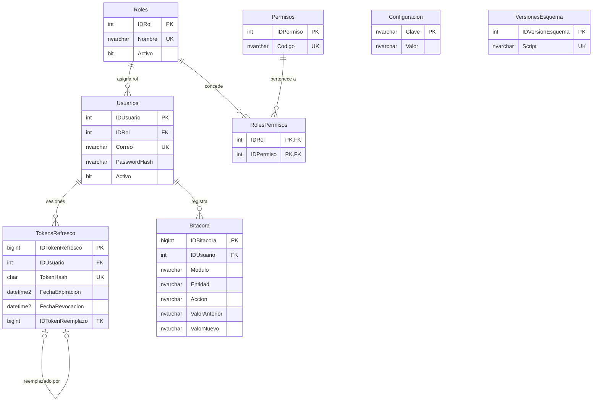
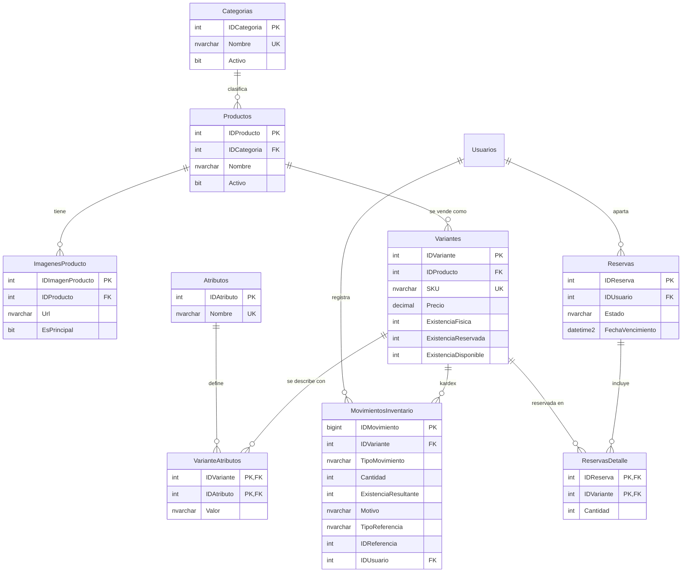
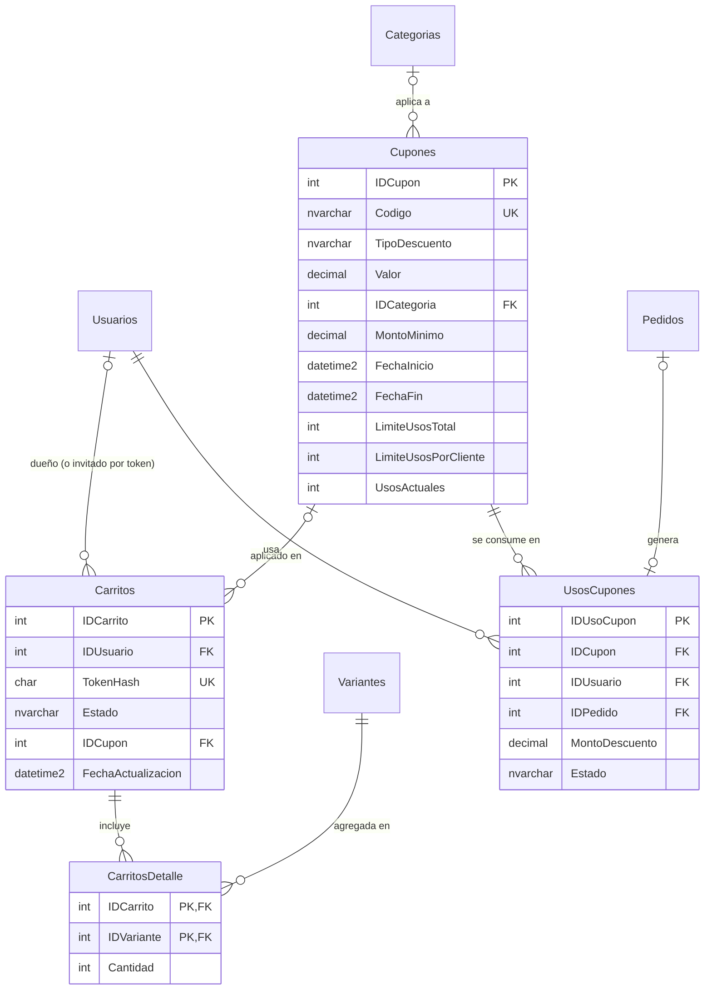
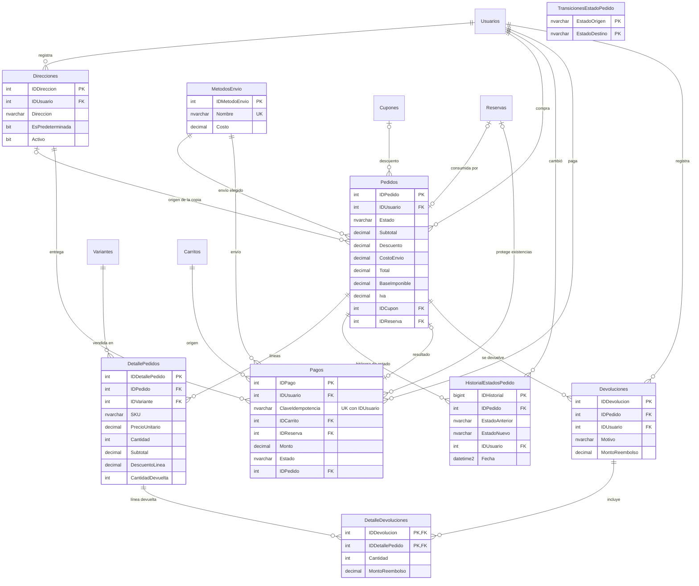

# Diagrama entidad-relación — ShopCart

Modelo relacional de la base de datos `ShopCart` (SQL Server): **30 tablas** creadas con scripts SQL propios, sin ORM. El modelo se divide por dominios para que cada diagrama sea legible. Las tablas que aparecen en más de un diagrama se repiten solo con sus llaves.

Convenciones: `PK` llave primaria, `FK` llave foránea, `UK` restricción `UNIQUE`. Los nombres siguen el estándar del reto (`IDNombre` para llaves primarias autoincrementables).

> Todas las fechas se almacenan en UTC (`DATETIME2(0)`). Todos los montos son `DECIMAL`; no existe ningún `FLOAT` ni `REAL`.

## 1. Seguridad, bitácora y configuración

## 2. Catálogo e inventario

`ExistenciaDisponible` es una columna calculada (`ExistenciaFisica − ExistenciaReservada`). `ExistenciaFisica` siempre es igual a la suma de `MovimientosInventario.Cantidad` (ver `VW_Inventario_Conciliacion`).

## 3. Carrito y cupones

Un carrito pertenece **exactamente** a un usuario o a un invitado (`CK_Carritos_Propietario`). De los tokens de invitado solo se guarda el hash.

## 4. Checkout, pedidos, pagos y devoluciones

`TransicionesEstadoPedido` no tiene llaves foráneas: es la tabla de referencia contra la que el trigger `TR_Pedidos_ValidarTransicion` valida cada cambio de `Pedidos.Estado`.

## Integridad que el modelo impone por sí mismo

| Regla | Mecanismo |
|---|---|
| Nunca hay sobreventa | `CK_Variantes_Existencias`: `0 ≤ ExistenciaReservada ≤ ExistenciaFisica` |
| Un cupón no excede su límite total | `CK_Cupones_Usos`: `UsosActuales ≤ LimiteUsosTotal` |
| Un cupón por pedido | Índice único `UX_UsosCupones_Pedido` |
| Un pago (y un pedido) por solicitud | `UX_Pagos_Clave (IDUsuario, ClaveIdempotencia)` y `UX_Pagos_Pedido` |
| Una reserva activa por usuario | Índice único filtrado `UX_Reservas_UsuarioActiva` |
| Un carrito activo por usuario | Índice único filtrado `UX_Carritos_UsuarioActivo` |
| No se devuelve más de lo vendido | `CK_DetallePedidos_Devuelta`: `0 ≤ CantidadDevuelta ≤ Cantidad` |
| Los montos del pedido cuadran | `CK_Pedidos_Montos`: `Total = Subtotal − Descuento + CostoEnvio` y `Base + IVA = Total` |
| Precios y montos congelados | Triggers `TR_Pedidos_Congelado` y `TR_DetallePedidos_Congelado` |
| Solo transiciones de estado válidas | Trigger `TR_Pedidos_ValidarTransicion` + `TransicionesEstadoPedido` |
| Bitácora, kardex, historial y devoluciones inmutables | Triggers `INSTEAD OF UPDATE, DELETE` |
| Usuarios, pedidos y líneas no se eliminan | Triggers `INSTEAD OF DELETE` |